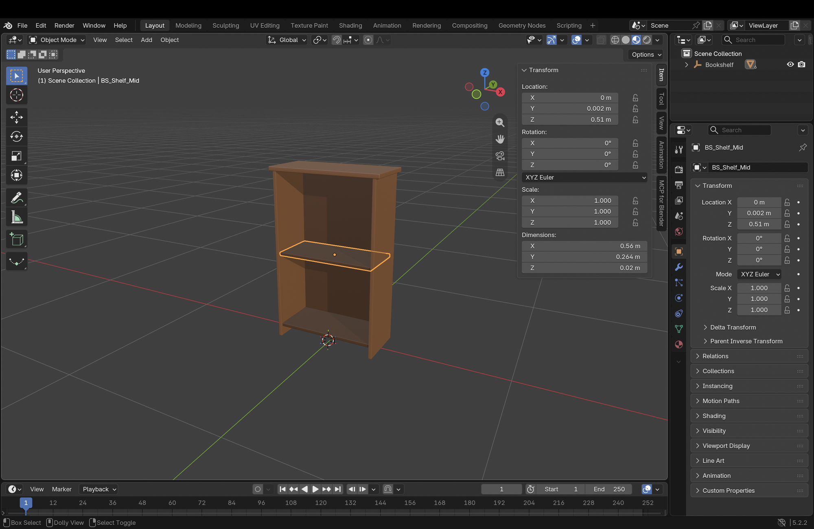

# My Blender Work and Experience

**Blender** 5.2.2 LTS · macOS 26.6.2, Apple Silicon · written 2026-10-15, in my own words

My screenshot: `evidence/a3-blender-window.png` — my own session, `bookshelf.blend` open, the
middle shelf `BS_Shelf_Mid` selected, the N sidebar open on its Item tab.

## 1. Getting Started With Blender — October 14

I opened Blender for the first time and started exploring the software. Since I was new to Blender, I spent some time understanding the interface and where different options are available.

I installed the Blender MCP add-on from Edit → Preferences → Add-ons. At first, I got an error saying "No module named...", so I closed Blender and opened it again. After restarting, the add-on worked.

I opened the MCP tab from the N sidebar and clicked Connect. It showed "Connected on port 9876". I kept all the download and generation options turned off.

## 2. Exploring Blender and Checking the Models

After the models were created, I spent some time checking them manually in Blender.

At first, I was a little confused with moving around in the 3D viewport. I tried rotating the view, zooming in and out, and looking at the objects from different angles.

I also explored different parts of the Blender interface.

- **3D Viewport:** I used this to rotate around the models, zoom in and out, and check how they look from different sides.
- **Toolbar:** I used the move tool and the coloured arrows to change the position of objects.
- **Outliner:** I used this to see all the objects and their parts. It was useful when I wanted to select a particular shelf or check duplicated objects.
- **Properties Editor:** I opened the Material tab and checked the wood material, base colour, and roughness settings.
- **N Sidebar:** I opened the Item tab and checked the location, rotation, scale, and dimensions. For example, one shelf had dimensions of 0.56 × 0.264 × 0.02 m.
- **Mode Selector:** I worked in Object Mode while selecting, moving, and checking the objects.

Sometimes when I was trying to select one part of the model, I selected another part by mistake. So I started using the Outliner to find the correct object.

I also tried looking at the models from the front, side, and top views to understand how the parts were placed.

I checked the difference between Solid View and Material Preview. Solid View was useful to see the shape of the objects, while Material Preview helped me see the actual colours and materials.

I also tried selecting different objects and noticed the orange outline around the selected object. This helped me understand which object I was currently working on.

I checked the Transform values in the Item tab and noticed that the location values changed when I moved an object.

While checking the models, I noticed the first music box was looking too simple and the first lamp was looking a little old-fashioned. So I decided to change their designs.

I also took screenshots of my Blender session to keep a record of the work.

## 3. Manual Editing of the Bookshelf — October 15

I wanted to try making some changes to the bookshelf by myself instead of doing everything through Claude.

First, I selected a shelf and pressed Shift+D to duplicate it. But it also duplicated the parent object and created Bookshelf.001.

I noticed the new object in the Outliner and used Cmd+Z to undo it.

After that, I tried moving the shelves using the move tool. At first, I was having some difficulty because when I tried moving a shelf up, it was also moving sideways or backward.

I tried using the coloured arrows to control the direction. This was a little easier than moving the object freely.

I also tried using the G shortcut to move objects and used undo when something went wrong.

After trying a few times, I duplicated a shelf and moved it closer to the bottom of the bookshelf to make a third shelf.

I zoomed in to check the placement of the shelves and whether they were properly aligned with the side panels.

I also checked the objects in the Outliner and noticed some names had .001 added to them. There was also a duplicated material.

I tried hiding some objects using the eye icon in the Outliner to see the other parts more clearly, and then made them visible again.

I decided to remove the back panel from the bookshelf because I wanted the final model to have only six boards.

While making these changes, I understood that even a small edit can affect the object position or create unwanted duplicates.

## 4. Checking Materials and Object Details

I spent some time checking how the materials were applied to the models.

I opened the Material Properties tab and looked at the material settings, including M_Wood_Warm.

I checked the base colour and roughness values to understand how they affect the appearance of the object.

I switched between Solid View and Material Preview to compare how the models were looking.

I also zoomed in on different parts of the models to check the edges, corners, and how the different parts were connected.

I was mostly exploring these settings and understanding what they do rather than making big changes to the materials manually.

## 5. Blender Crash and Reconnection

While working, Blender crashed once because of an error in the code Claude was running.

I opened Blender again and went to Preferences to enable the MCP add-on.

I saved the preferences and connected MCP again so I could continue working.

This also helped me understand how to reconnect Blender with Claude when the connection is lost.

## 6. Using Claude With Blender MCP

I used Claude through Blender MCP to create the three models. Claude was doing most of the actual modeling using Python code inside Blender.

Before creating anything, Claude checked the scene using `get_scene_info`.

Then it created the different parts of each model and checked their location, size, rotation, and scale.

I was checking the results in Blender and deciding what changes were needed.

**Music Box**

The first music box was looking too simple, so I wanted to improve the design and add more details. Claude rebuilt the model based on the changes.

**Lamp**

The first lamp looked a little old-fashioned, and I wanted something more modern. I reviewed the design and Claude made another version.

**Bookshelf**

For the bookshelf, I wanted a simple design with six boards. I also wanted the shelves to be properly placed, and I accepted Claude's suggestion to make them a darker wood.

After my manual edits, some shelves were not aligned correctly and there were unwanted duplicated objects.

Claude helped fix the shelf positions, remove the duplicate objects, change the shelf materials, and remove the back panel.

Claude also fixed some problems in its own modeling code, including the music box cavity, the key shape, and the bevels.

It also helped save the Blender files, collect model information, capture screenshots, and record the turntable videos.

## 7. Problems I Faced

Since this was my first time using Blender, I faced some small problems while working.

One problem was understanding how to move objects in 3D. Sometimes I wanted to move an object up, but it was also moving in another direction.

Another problem was selecting the correct object. Sometimes I clicked on the wrong part, especially when multiple objects were close to each other.

I also accidentally duplicated the parent object while trying to duplicate only one shelf.

At first, I didn't understand why Blender was adding .001 to some object names. Later, I understood that these were duplicated objects or materials.

I used the Outliner, move arrows, and undo option to fix some of these mistakes.

I also had to restart Blender and reconnect MCP after the crash.

## 8. What I Learned

Before starting this work, I didn't have experience using Blender, so I was learning while doing the work.

At first, I was mostly exploring the interface and checking the models. Later, I started trying small changes by myself, like selecting objects, duplicating shelves, and moving them.

I learned how to use the viewport to check models from different angles and how the Outliner helps to find and select objects.

I also understood how the Properties Editor and N sidebar show information about the objects, like their materials, location, rotation, scale, and dimensions.

One thing I found difficult was moving objects in 3D because I had to understand the different axes. After trying a few times, I became a little more comfortable using the move tool.

I also learned that it is important to check the models manually because sometimes the generated design may not look exactly how I wanted.

Claude helped with most of the modeling and technical changes, but I was checking the models, giving feedback, making design decisions, and trying some manual edits myself.

Overall, I got more familiar with Blender and understood some of its basic tools. I am still a beginner, but this work helped me understand how to use Blender along with AI tools to create and improve 3D models.
